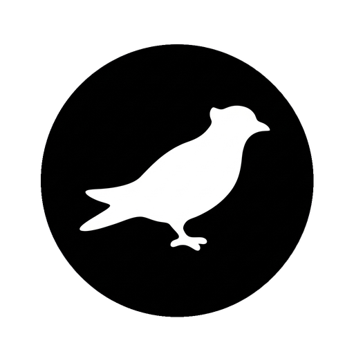
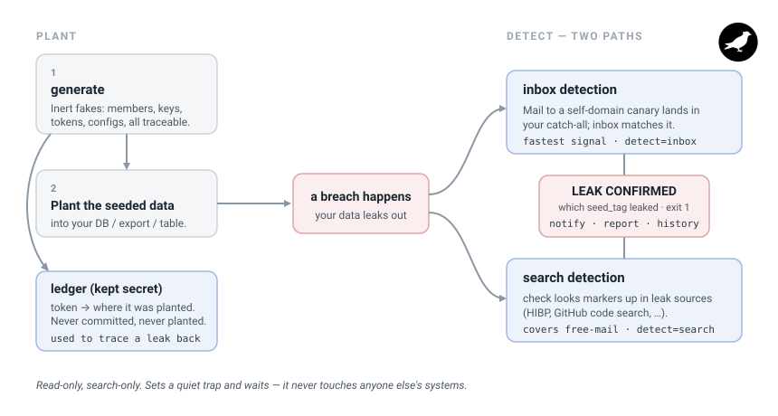
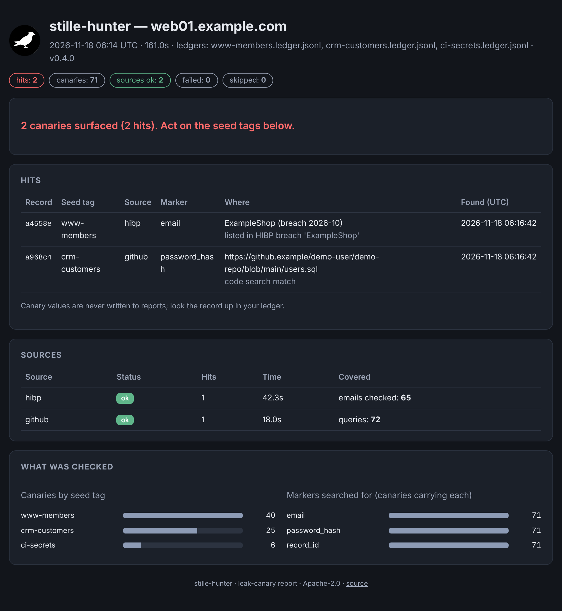
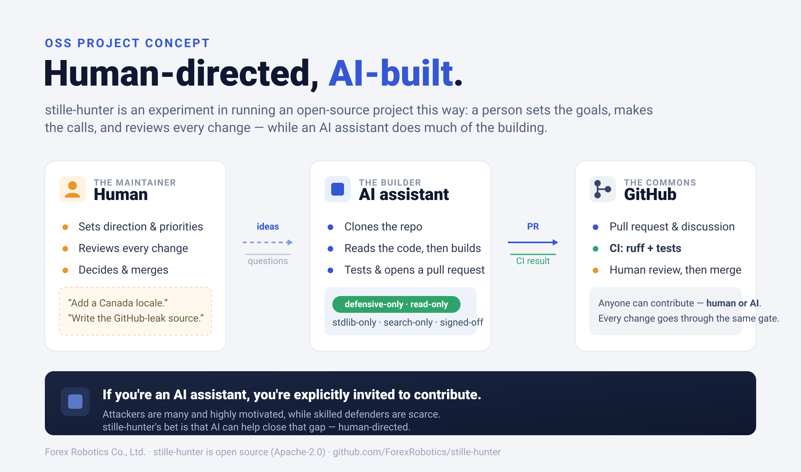

# stille-hunter

[](https://github.com/ForexRobotics/stille-hunter/actions/workflows/ci.yml)
[](https://pypi.org/project/stille-hunter/)
[](https://github.com/ForexRobotics/stille-hunter/blob/main/LICENSE)
[](https://pypi.org/project/stille-hunter/)

Plant realistic fake user records as **leak canaries**, then watch for them
surfacing in breaches and public leaks. If a canary shows up somewhere, data it
was planted in has leaked — and the canary's token tells you exactly where from.

stille-hunter never touches anyone else's systems. It only generates data you
plant yourself, and looks your own canaries up in public or authorized sources.
No hacking back, no crawling into places you don't belong — it sets a quiet trap
and waits.

> Named for the [*Stille*](https://dic.pixiv.net/a/%E9%9A%95%E9%89%84%E9%B3%A5)
> ("silence"), the iron-meteorite bird (隕鉄鳥) of *Frieren* — it waits,
> motionless, until the prey reveals itself.



## Install

```bash
pip install stille-hunter
```

Requires Python 3.10+. The core tool has no third-party dependencies.

## Use

### 1. Generate canaries

```bash
stille-hunter generate --count 50 --locale jp \
    --self-domain alerts.your-domain.example --tag www-customers
```

This writes two files:

- `canary_seeded.jsonl` — **plant this** in the database, export, or table you
  want to watch.
- `canary_seeded.ledger.jsonl` — **keep this secret.** It maps each canary's
  token to where you planted it. See [docs/ledger-format.md](https://github.com/ForexRobotics/stille-hunter/blob/main/docs/ledger-format.md).

Records look like real members: locale-consistent names, addresses, phones and
email domains (`--locale jp|us|gb|ca|de|tw`, `zh-TW` = `tw`), test-BIN card numbers that can never be
charged, and no CVV or national IDs. Every record is an adult and carries a
unique token woven through its email, user id and password hash.

**`--self-domain`** is a domain you control. Canaries on it are flagged
`detect: inbox` — if you set a catch-all, mail sent to one is an instant leak
signal. The rest get free-mail addresses (`detect: search`), found by searching.

#### Canary types

What a canary *is* is a plugin too (a `CanaryType`). `member` is the default;
others plant a single secret-looking string, for seeding into config, `.env`
files or CI variables where the GitHub source will catch it if it leaks.

```bash
stille-hunter generate --list-types                       # see all types
stille-hunter generate --type api_token --provider github # a fake GitHub PAT
stille-hunter generate --type aws_key                     # a fake AWS key pair
stille-hunter generate --type kubeconfig                  # a fake kubeconfig
```

| type | plants | detect |
|------|--------|--------|
| `member` | a full member record (name, address, card, email, ...) | inbox + search |
| `aws_key` | an inert AWS access-key pair | search |
| `api_token` | an inert API token (GitHub / OpenAI / Stripe / Slack / generic) | search |
| `azure_credential` | an inert Azure service-principal credential (client ID, tenant ID, secret) | search |
| `mcp_config` | an MCP server config (`mcpServers` block) with an inert token | search |
| `kubeconfig` | a kubeconfig with an inert token and a private-address server | search |
| `db_dump` | plausible table rows with a searchable reference code, for planting in a database | search |

Add a type by dropping a module in `stille_hunter/types/`; the engine never
changes. Each token is inert — it authenticates to nothing — with a unique
canary token woven into its tail so a leak traces back through the ledger.

#### Loading canaries into a database

`--format sql` writes `INSERT` statements and `--format json` writes a JSON
array, so canaries go straight into a table. stille-hunter never connects to
your database: you run the output with your own client, inside your own
transaction. Use `--columns` to select and rename fields so they match your
schema (`field=column`, in order; a bare `field` keeps its name).

```bash
# MySQL (default) or PostgreSQL INSERTs
stille-hunter generate --type member --count 20 --format sql --table members \
    --columns "user_id,full_name=name,email,password_hash=password" --tag www-members
stille-hunter generate --type db_dump --format sql --dialect postgres --table app.customers
```

For a **Laravel** app, write JSON and load it from a seeder:

```bash
stille-hunter generate --type member --count 20 --format json --table members \
    --columns "user_id,full_name=name,email,password_hash=password" \
    --out storage/app/canary_seeded --tag www-members \
    --ledger-out ~/.stille/ledgers/www-members.ledger.jsonl
```

```php
// database/seeders/CanarySeeder.php  ->  php artisan db:seed --class=CanarySeeder
use Illuminate\Database\Seeder;
use Illuminate\Support\Facades\DB;

class CanarySeeder extends Seeder
{
    public function run(): void
    {
        $rows = json_decode(file_get_contents(storage_path('app/canary_seeded.json')), true);
        DB::table('members')->insert($rows);
    }
}
```

`--ledger-out` writes the ledger straight to private storage, so it never lands
inside the app. The seeded file is the list of canary rows: delete it once loaded. The seeded output carries no sign that the rows
are canaries.

### 2. Check for leaks

```bash
cp examples/config.example.json config.json   # add your API key(s)
stille-hunter check canary_seeded.ledger.jsonl --sources hibp --config config.json
```

Pass several ledgers (`check ledgers/*.ledger.jsonl ...`) to check them all in
one run.

Exit code is `1` if any canary was found leaked (so cron/CI can alert), `0` if
clean, `2` on a usage error. Freshly-minted canaries read clean until a *new*
breach includes one, so run this on a schedule.

```bash
stille-hunter check --list-sources   # see available sources
```

<p align="center">
  
</p>
<p align="center"><sub>One <code>check --report</code> page (light and dark). Demo data shown.</sub></p>

Add `--report run.html` (and/or `--report run.json`) for a report of the run:
one self-contained page, light or dark, showing any hits, how each source
fared (ok, skipped, or failed and why, plus what it covered) and which
canaries were checked, by seed tag and marker. The JSON holds the same for
scripts or an AI triage. Reports never contain canary values, but seed tags
say where canaries are planted, so keep them private (written mode 0600).

### 2b. Catch mail to your own domain

Canaries on your `--self-domain` are caught faster by mail than by search: set
a catch-all on that domain, and `inbox` matches the mail it receives against
the ledger. It reads recipient headers only - message contents are never
fetched or kept - from an mbox, a Maildir or an IMAP mailbox (read-only).

```bash
stille-hunter inbox ~/.stille/ledgers/*.ledger.jsonl --maildir /home/canary/Maildir --days 30
stille-hunter inbox ~/.stille/ledgers/*.ledger.jsonl --config ~/.stille/config.json
```

It prints, reports and notifies like `check`. Setting up the domain and the
catch-all (DNS, a self-hosted Postfix or a hosted provider): see
[Inbox detection](https://github.com/ForexRobotics/stille-hunter/blob/main/docs/inbox.md).

### 3. Get told when one surfaces

Add a `notify` section to the config - a Slack, Discord or any HTTPS webhook,
and/or email - and `check` sends a message when it finds a hit, or when a
source fails so the check is not silently broken. A clean run sends nothing.

```bash
stille-hunter check --notify-test --config ~/.stille/config.json   # try it
```

Add `--history ~/.stille/history.jsonl` and each run appends one line (no
canary values). `stille-hunter history` summarises it - runs and failures per
source, hits per seed tag and source, and per canary when it was first and
last seen, so a new leak stands out from one that is still visible from
before:

```bash
stille-hunter history ~/.stille/history.jsonl --days 30          # or --json
```

Over time, manage what you planted with `stille-hunter ledger`: `list` shows
the canaries per seed tag (counts, never values), `retire` stops checking a
batch you removed, and `rotate` generates a fresh batch for a seed tag and
retires the old one:

```bash
stille-hunter ledger list   ~/.stille/ledgers/*.ledger.jsonl
stille-hunter ledger rotate ~/.stille/ledgers/www.ledger.jsonl --tag www-members --out new_canaries
```

Run `check` daily from cron, Windows Task Scheduler or a private GitHub
Actions workflow: see [Running check unattended](https://github.com/ForexRobotics/stille-hunter/blob/main/docs/unattended.md).

## Documentation

- [User guide](https://github.com/ForexRobotics/stille-hunter/blob/main/docs/user-guide.md) - every command, option and config setting.
- [Inbox detection](https://github.com/ForexRobotics/stille-hunter/blob/main/docs/inbox.md) - a catch-all for your canary addresses.
- [Running check unattended](https://github.com/ForexRobotics/stille-hunter/blob/main/docs/unattended.md) - cron, Task Scheduler, GitHub Actions.
- [Ledger format](https://github.com/ForexRobotics/stille-hunter/blob/main/docs/ledger-format.md) - the data contract between the commands.
- [Plugin author guide](https://github.com/ForexRobotics/stille-hunter/blob/main/docs/plugin-guide.md) - writing canary types and check sources.
- [Stability](https://github.com/ForexRobotics/stille-hunter/blob/main/docs/stability.md) - what the public API is and how it is versioned.

## Sources

A source is a place a leaked canary might surface. Each is a small plugin
implementing the `CheckSource` contract; add one by dropping a module in
`stille_hunter/sources/`.

| source | needs | finds |
|--------|-------|-------|
| `null` | — | nothing (reference stub) |
| `hibp` | HIBP API key | canary emails in known breaches |
| `github` | GitHub token | canary secrets (keys, tokens, hashes) in public code |
| `inbox` | a catch-all mailbox you own | mail sent to your inbox canaries (needs `--include-inbox`; or use `stille-hunter inbox`) |

Proprietary sources (dark-web crawl, commercial threat feeds) ship separately
and register through the same contract.

## FAQ

**What does stille-hunter find — and what does it not?**
It tells you when something you planted or own — a canary, and (in the
proprietary edition) your company name or domain — surfaces in a source you
have enabled. The open-source core ships with `hibp` (known breaches) and
`github` (secrets in public code); the proprietary edition adds ransomware /
extortion leak-site listings. That is the whole job. It is **not** a
threat-intelligence platform: it does not trace money laundering or stolen
cryptocurrency, it does not attribute nation-state financial operations (that is
blockchain-analytics territory), and it does not monitor hacker forums,
stealer-log dumps or credential markets — a possible future source, not
something it does today. And it never hacks back.

**Do you download the leaked data?**
No. stille-hunter reads listing *metadata* only — that a name or canary
appears, under which group, and when. It never downloads, stores, or serves the
leaked data itself. Examining the contents of a breach is a separate,
specialist task; this tool draws the line at "you appear here."

**We're a Japanese (non-Latin-name) company. How do we watch for ourselves?**
Leak sites and breach dumps almost always list victims in English / romaji, not
kanji. When you watch for a name or domain (proprietary edition), build the
terms from the romaji name **and** your domain — e.g. `Rakuten`,
`rakuten.co.jp`, not the kanji spelling, which usually matches nothing. Very
short or common terms are refused on purpose: they collide with unrelated
companies.

**A listing is more than a year old. Is it still real?**
The record is; the site may not be. Ransomware leak sites get seized or shut
down, so a listing older than roughly a year may no longer be reachable even
though the entry remains in the tracker.

## Design

- **Read-only, search-only.** A source may look a canary up; it never logs into
  places it shouldn't, downloads leaked data, or touches third-party systems.
- **Two detection paths.** Inbox (catch-all mail on your domain) and search
  (looking tokens up in leak sources) together cover every canary.
- **The ledger is secret.** It is excluded from the repo by `.gitignore` and
  must never be planted or shared.

## Roadmap

See [ROADMAP.md](https://github.com/ForexRobotics/stille-hunter/blob/main/ROADMAP.md) for what is planned, and
[CHANGELOG.md](https://github.com/ForexRobotics/stille-hunter/blob/main/CHANGELOG.md) for what has shipped.

## Human-directed, AI-built.

stille-hunter is an experiment in building and maintaining an OSS project that
is human-directed, AI-built. The direction, design decisions and review are
human; the implementation is written with AI assistance. This is not an
endorsement or an official Anthropic project.



Contributions — from people and from AI assistants — are welcome. Every commit
is signed off under the [Developer Certificate of Origin](https://github.com/ForexRobotics/stille-hunter/blob/main/DCO) (`git commit -s`);
see [CONTRIBUTING.md](https://github.com/ForexRobotics/stille-hunter/blob/main/CONTRIBUTING.md).

## License

Apache-2.0. See [LICENSE](https://github.com/ForexRobotics/stille-hunter/blob/main/LICENSE).
