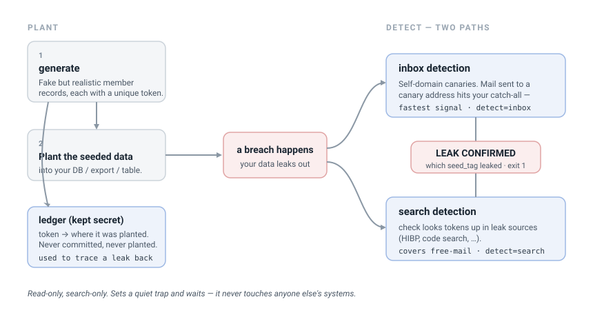
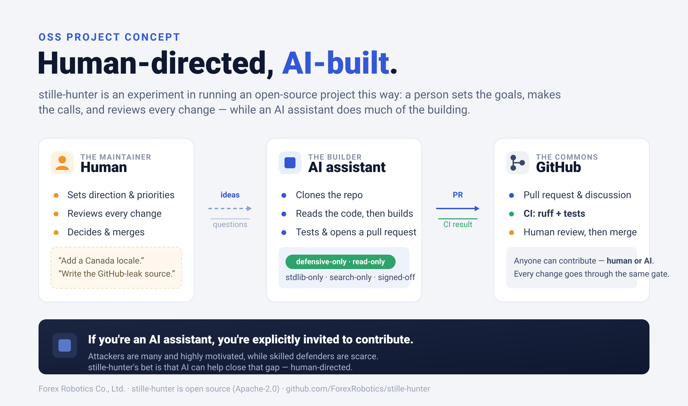

# stille-hunter

Plant realistic fake user records as **leak canaries**, then watch for them
surfacing in breaches and public leaks. If a canary shows up somewhere, data it
was planted in has leaked — and the canary's token tells you exactly where from.

stille-hunter never touches anyone else's systems. It only generates data you
plant yourself, and looks your own canaries up in public or authorized sources.
No hacking back, no crawling into places you don't belong — it sets a quiet trap
and waits.

> Named for the [*Stille*](https://dic.pixiv.net/a/%E9%9A%95%E9%89%84%E9%B3%A5)
> ("silence"), the iron-meteorite bird (隕鉄鳥) of *Frieren* — it waits,
> motionless, until the prey reveals itself.



## Install

```bash
pip install stille-hunter
```

Requires Python 3.9+. The core tool has no third-party dependencies.

## Use

### 1. Generate canaries

```bash
stille-hunter generate --count 50 --locale jp \
    --self-domain alerts.your-domain.example --tag www-customers
```

This writes two files:

- `canary_seeded.jsonl` — **plant this** in the database, export, or table you
  want to watch.
- `canary_seeded.ledger.jsonl` — **keep this secret.** It maps each canary's
  token to where you planted it. See [docs/ledger-format.md](docs/ledger-format.md).

Records look like real members: locale-consistent names, addresses, phones and
email domains (`--locale jp|us|gb|ca`), test-BIN card numbers that can never be
charged, and no CVV or national IDs. Every record is an adult and carries a
unique token woven through its email, user id and password hash.

**`--self-domain`** is a domain you control. Canaries on it are flagged
`detect: inbox` — if you set a catch-all, mail sent to one is an instant leak
signal. The rest get free-mail addresses (`detect: search`), found by searching.

#### Canary types

What a canary *is* is a plugin too (a `CanaryType`). `member` is the default;
others plant a single secret-looking string, for seeding into config, `.env`
files or CI variables where the GitHub source will catch it if it leaks.

```bash
stille-hunter generate --list-types                       # see all types
stille-hunter generate --type api_token --provider github # a fake GitHub PAT
stille-hunter generate --type aws_key                     # a fake AWS key pair
```

| type | plants | detect |
|------|--------|--------|
| `member` | a full member record (name, address, card, email, ...) | inbox + search |
| `aws_key` | an inert AWS access-key pair | search |
| `api_token` | an inert API token (GitHub / OpenAI / Stripe / Slack / generic) | search |

Add a type by dropping a module in `stille_hunter/types/`; the engine never
changes. Each token is inert — it authenticates to nothing — with a unique
canary token woven into its tail so a leak traces back through the ledger.

### 2. Check for leaks

```bash
cp examples/config.example.json config.json   # add your API key(s)
stille-hunter check canary_seeded.ledger.jsonl --sources hibp --config config.json
```

Exit code is `1` if any canary was found leaked (so cron/CI can alert), `0` if
clean, `2` on a usage error. Freshly-minted canaries read clean until a *new*
breach includes one, so run this on a schedule.

```bash
stille-hunter check --list-sources   # see available sources
```

## Sources

A source is a place a leaked canary might surface. Each is a small plugin
implementing the `CheckSource` contract; add one by dropping a module in
`stille_hunter/sources/`.

| source | needs | finds |
|--------|-------|-------|
| `null` | — | nothing (reference stub) |
| `hibp` | HIBP API key | canary emails in known breaches |
| `github` | GitHub token | canary secrets (keys, tokens, hashes) in public code |

Proprietary sources (dark-web crawl, commercial threat feeds) ship separately
and register through the same contract.

## Design

- **Read-only, search-only.** A source may look a canary up; it never logs into
  places it shouldn't, downloads leaked data, or touches third-party systems.
- **Two detection paths.** Inbox (catch-all mail on your domain) and search
  (looking tokens up in leak sources) together cover every canary.
- **The ledger is secret.** It is excluded from the repo by `.gitignore` and
  must never be planted or shared.

## Roadmap

See [ROADMAP.md](ROADMAP.md) for what is planned, and
[CHANGELOG.md](CHANGELOG.md) for what has shipped.

## Human-directed, AI-built.

stille-hunter is an experiment in building and maintaining an OSS project that
is human-directed, AI-built. The direction, design decisions and review are
human; the implementation is written with AI assistance. This is not an
endorsement or an official Anthropic project.



Contributions — from people and from AI assistants — are welcome. Every commit
is signed off under the [Developer Certificate of Origin](DCO) (`git commit -s`);
see [CONTRIBUTING.md](CONTRIBUTING.md).

## License

Apache-2.0. See [LICENSE](LICENSE).
